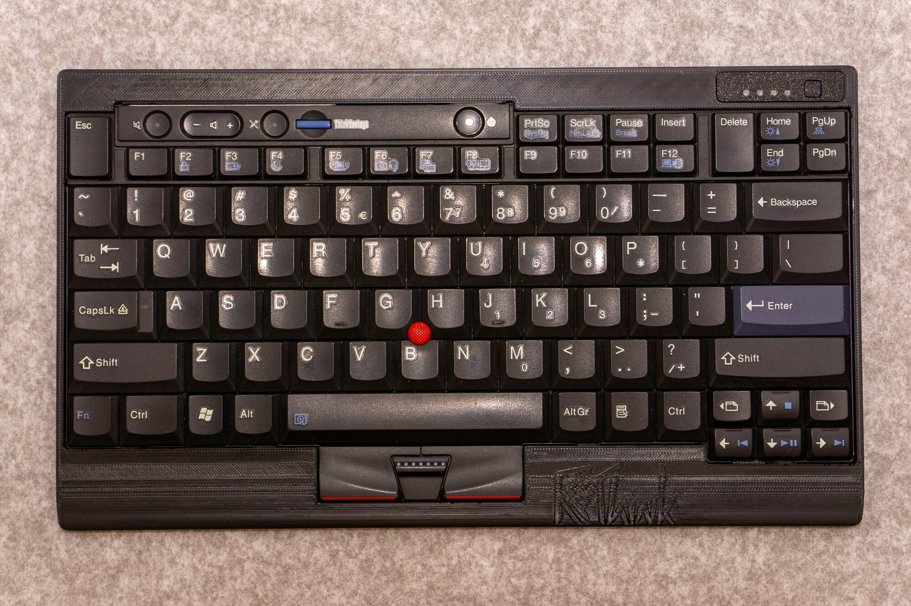
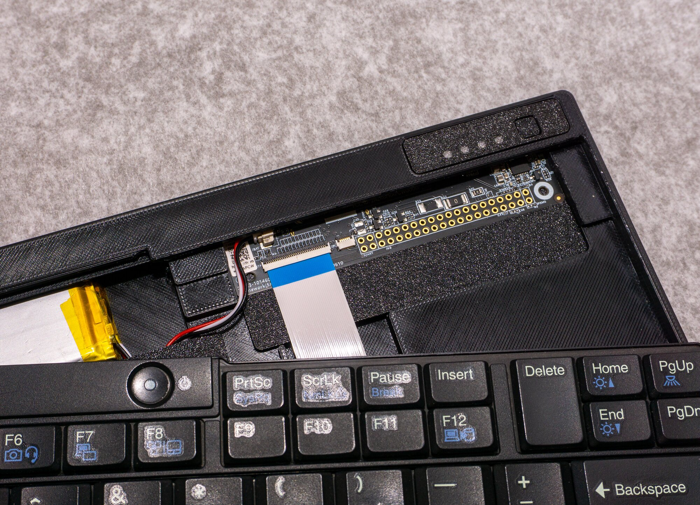

 

### Adapting older ThinkPad laptop keyboard modules into standalone keyboards using Framework Control Board.

## Hardware overview
- **Framework Control Board** - nRF54LM20A, Bluetooth/dongle/USB-C connection, nPM1300 power management IC.
- **ReThink Adapter Board** - bridge between Control Board and ThinkPad keyboards.
- **3D Printed case** - housing for components, different for each keyboard type.
- **ThinkPad keyboard modules** - 6 and 7row, classic and chiclet, with or without backlight, with integrated Pointing Stick (nub) and mouse keys. Full list TBD.
- **ZMK Firmware** - based on Zephyr RTOS, provides customizability. Each keyboard type will be different shield. See [rethink-zmk-config](https://github.com/Ziemniaczenka/rethink-zmk-config).

> Note: This is preliminary information. Everything is subject to change and more information will follow.

## Status

- [x] Adapter Board:    V1.0 designed, PCBs ordered
- [ ] Firmware:         repo configured, test configurations WIP.
- [ ] Case:             WIP for T420/T430, not yet started for others.

## Reference pinouts

- [Framework Control Board FFC connectors](docs/pinouts/framework_ffc.md)
- [Mezzanine Connector (e.g. T60/T420)](docs/pinouts/mezzanine.md)
- [FFC1 (e.g. L420)](docs/pinouts/ffc1.md)
- [FFC2 (e.g. T480/T580/L14)](docs/pinouts/ffc2.md)
- [PCAL6416A IO expander](docs/pinouts/io_expander.md) - expander pins, solder jumpers

## Mechanical CAD

- TBD

First case prototype (T420), 3D printed:

 

##  

Adapter board connects to Control Board using FFC cables, has connectors for different generations of ThinkPad keyboards, boost converters (for pointing stick, backlight) and I2C IO expander (required to keep all keyboard buttons and diodes functional).

Variants:
| Variant        | Connectors       | Backlight |
| -------------- | ---------------- | :-------: |
| Full (Default) | Mezz, FFC1, FFC2 |     ✅     |
| Mezz_no_BL     | Mezz             |     ❌     |
| FFC1           | FFC1             |     ❌     |
| FFC2           | FFC2             |     ✅     |

Solder jumpers change the defaults if needed:
- Pointing Stick supply 5V or 3V3, separately for Mezzanine/FFC1 and FFC2 (with level shifter bypass).
- IO expander supply: always on LED_3V3 (default) or switched TP_3V3.
- Charge pump and backlight boost always on, instead of controlled by the IO expander.
- 5V for T430 backlight on the Mezzanine connector (JP3, **only** for T430-like keyboards).

Defaults, jumper positions and the matching firmware options are in [IO expander](docs/pinouts/io_expander.md).

- [Schematic](circuit/ReThink_adapter_Schematic.pdf)
- [PCB](circuit/ReThink_adapter_PCB.pdf)
- [BOM](circuit/ReThink_adapter/bom/ReThink_adapter_default.csv)

## Battery

- Picoblade 3-pin with NTC thermistor.
- TBD

## Firmware and Bootloader

- ZMK configuration: [rethink-zmk-config](https://github.com/Ziemniaczenka/rethink-zmk-config) (MIT), work in progress.
- Builds in Docker, the same way locally and on GitHub Actions. No Zephyr SDK needed on the PC.
- Control Board comes with MCUboot, so no programmer is needed. Flashing over USB:
  - hold the pairing button while plugging in USB,
  - or, with battery connected, hold the pairing button for 10s.
- Adapter jumpers and Control Board options (e.g. backlight power source) are set in one file: `config/rethink.conf`.

## Compatibility Table

Planned, nothing tested on real keyboards yet.

| Keyboards                                                                                               | Connector | Backlight   (optional) | Pointing Stick supply   (**default**) | Board support | Firmware config | Case |
| ------------------------------------------------------------------------------------------------------- | --------- | ------------------------- | ---------------------------------------- | ------------- | --------------- | ---- |
| T60, T61, T400, R60, R61, R400, R500, W500, W700                                                        | Mezzanine | ❌                         | 5V                                       |               |                 |      |
| T410, T420, T510, T520, W510, W520, X220                                                                | Mezzanine | ❌                         | 5V                                       |               |                 | WIP  |
| T430, T530, W530, X230                                                                                  | Mezzanine | ✅                         | 5V                                       |               |                 | WIP  |
| L410, L412, L420, L421, L510, L512, L520, SL300, SL410, SL510                                        | FFC1      | ❌                         | 5V                                       |               |                 |      |
| T470, T480, A475, A485                                                                                  | FFC2      | ✅                         | 3V3                                      |               |                 |      |
| T570, T580, P51s, P52s                                                                                  | FFC2      | ✅                         | 3V3                                      |               |                 |      |
| L14g1, L14g2                                                                                            | FFC2      | ✅                         | 3V3                                      |               |                 |      |
| L15g1, L15g2                                                                                            | FFC2      | ✅                         | 3V3                                      |               |                 |      |
| E480, E485, E490, E495, L380, L390, L480, L490, T480s, T490, T14g1, T14g2, P43, P43s, P14sG1, P14sG2 | FFC2      | ✅                         | 3V3                                      |               |                 |      |
| E580, E585, E590, E595, L580, L590, T590, P52, P53, P53s, P72, P73                                   | FFC2      | ✅                         | 3V3                                      |               |                 |      |
| T15g1, T15g2, P15sG1, P15sG2                                                                            | FFC2      | ✅                         | 3V3                                      |               |                 |      |
| P15g1, P15g2, P17g1, P17g2                                                                              | FFC2      | ✅                         | 3V3                                      |               |                 |      |

Full lists in the connector pinouts.

## License

ReThink keyboard by Ziemniaczenka is licensed under CC BY-SA 4.0.
To view a copy of this license, visit https://creativecommons.org/licenses/by-sa/4.0/

Firmware ([rethink-zmk-config](https://github.com/Ziemniaczenka/rethink-zmk-config)) is licensed under MIT.

Component 3D models located under `circuit/libraries/3dmodels/` are the intellectual property of their respective manufacturers and are provided for reference/visualization purposes only. They are not covered by the above license; all rights remain with their original owners.

## Disclaimers
> Framework Control Board was provided pre-release by Framework Computer Inc. through Control Board Developer Program.

> ThinkPad and TrackPoint are registered trademarks of Lenovo. ReThink is an independent open-source project and is not affiliated with, endorsed by, or certified by Lenovo Group Limited.

## References
1. https://github.com/FrameworkComputer/Framework-Wireless-Touchpad-Keyboard
2. https://github.com/badjeff/kb_zmk_ps2_mouse_trackpoint_driver
3. https://github.com/rampadc/zmk-thinkpad
4. https://github.com/delingren/thinkpad_keyboards
5. https://github.com/Shaedil/zmk-config-fw-cb
6. https://github.com/zmkfirmware/zmk/pull/3387
